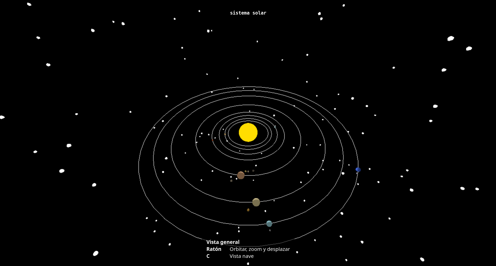

# Sistema Solar (IG semanas 6 y 7)

## Contenido
- [Trabajo realizado](#trabajo-realizado)
- [Controles](#controles)
- [Uso de IA](#uso-de-ia)

## Trabajo realizado
- Creación de un modelo del sistema solar con todos los planetas y algunos de los satélites
- Cámara orbital y con movimiento libre
- Textura, luz especular y relieve de la Tierra.

### Generación del sistema

El Sol se crea en las coordenadas (0, 0, 0).
Se usa el material básico, ya que no va a ser afectado por la luz.
Además, se crea una luz puntual en la misma posición, que es la que iluminará todo el sistema.

Aparte de la luz puntual, el sistema cuenta con una luz ambiente suave.

Los planetas se crean a partir de una lista.
Cada elemento de la lista es un objeto que representa el planeta con los siguientes detalles:
- Radio
- Distancia, excentricidad y periodo de la órbita
- Color del planeta
- Textura, relieve y mapa especular del planeta (únicamente la Tierra)

Los focos de la órbita se calculan a partir de la excentricidad.

Por su parte, los satélites están almacenados de forma similar en su propia lista.
Esta guarda, para cada planeta, una lista con sus satélites.

Los satélites tienen los siguientes parámetros:
- radio en km
- distancia y periodo de la órbita
- color

El sistema está creado a una escala reducida.
Esta escala se puede modificar en las variables en el bloque "escalas" al principio del código.
Cada una de las variables representa lo siguiente
- `SUN_RADIUS`: radio del Sol en unidades.
- `SUN_RADIUS_KM`: radio del Sol en kilómetros
- `SIZE_EXP`: exponente usado para calcular el tamaño de los planetas. Si la variable es 1, se mantendría la proporción real del sistema solar, lo que haría que muchos de los planetas no fueran apreciables.
- `DISTANCE_EXP`: similar a la anterior, pero para las distancias de las órbitas.
- `DISTANCE_SCALE`: multiplicador de la distancia
- `ORBIT_OFFSET`: distancia mínima que puede tener una órbita del Sol
- `ECCENTRICITY_BOOST`: multiplicador de la excentricidad de las órbitas. Para apreciar mejor la forma en las distancias reducidas.
- `MOON_SIZE_BOOST`: multiplicador del tamaño de los satélites. Facilita apreciarlos en el sistema.
- `MOON_MIN_RADIUS`: radio mínimo que tendrá un satélite.
- `ORBIT_MARGIN`: distancia mínima entre órbitas.

Los tamaños y distancias del sistema se calculan mediante las siguientes funciones:
- `moonRadius()`
- `getPlanetRadius()`
- `getOrbitDistance()`

Todas reciben como parámetros los valores reales y devuelven el valor usado en el renderizado del sistema.

### Generación del mapa de estrellas

Las estrellas se generan en posiciones aleatorias en cada ejecución, entre una distancia mínima y máxima del sistema solar.

## Controles

En ambos casos, pulsar la tecla **C** para cambiar el modo de la cámara.

### Cámara orbital

Arrastrar con el ratón para desplazar la cámara.

Zoom con la rueda del ratón.

### Cámara libre

Teclas W/S: avanzar/retroceder
Teclas A/D: moverse a la izquierda/derecha
Flechas: Girar cámara
Shift: Turbo

## Uso de IA

Se ha usado Claude para lo siguiente:
- Revisión del enunciado
- Generación de la lista de planetas con algunos detalles técnicos (radio, distancia, excentricidad y periodo de la órbita)
- Controles de cámara con movimiento libre
- Cambio entre la vista orbital y el modo de movimiento libre

